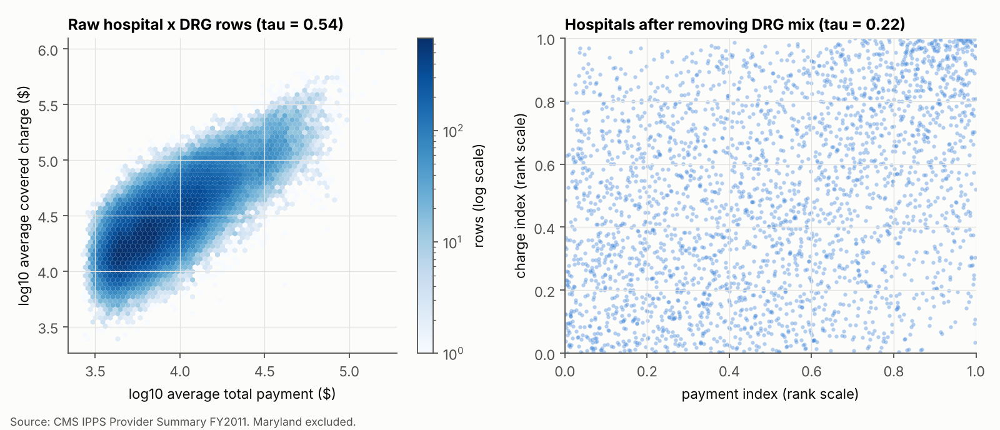
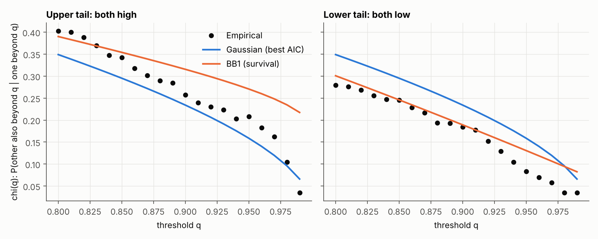
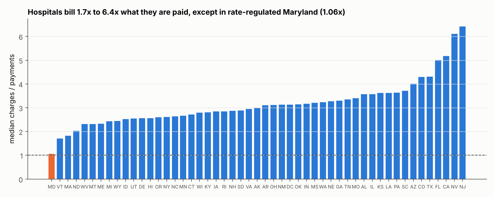

# Do the hospitals that charge the most also get paid the most?

**A copula analysis of hospital list prices and Medicare payments in the United States (CMS IPPS, FY2011)**

US hospitals publish list prices ("covered charges") that are far above what Medicare actually pays. This project asks how strongly a hospital's list prices are tied to its payments once you strip out case mix, and whether that tie gets stronger at the extremes. That second question matters for anyone who prices or reserves on billed amounts. If the most aggressive billers are also the best-paid hospitals, a model that assumes the two move together only "on average" will understate joint extreme exposure.

## Main findings

1. **Most of the raw correlation comes from case mix.** Across the 159,735 hospital × DRG rows, Kendall's tau between log charges and log payments is 0.54. After removing each DRG's mean and building one index per hospital, tau falls to **0.22 (95% CI 0.20–0.24)**. Removing state price levels as well brings it down to 0.15.
2. **The dependence is asymmetric.** Hospitals in the top 5% for charges are also in the top 5% for payments 21% of the time. In the bottom 5% the matching rate is only 8%. The gap (0.125) has a bootstrap 95% CI of 0.042 to 0.195, so it is unlikely to be noise.
3. **AIC alone picks the wrong kind of model.** The Gaussian copula has the lowest AIC, but a survival BB1 copula is within 0.9 AIC points. The Gaussian has no tail dependence and treats both tails the same, so it understates how often hospitals are high on both measures. The BB1 gives upper tail dependence of 0.17 (95% CI 0.12–0.22) and lower of 0.07 (0.03–0.11). Neither model matches the data exactly: the Gaussian predicts too few joint highs, and the BB1 predicts too many (figure 2).
4. **Maryland is the exception that confirms the mechanism.** Maryland sets hospital rates for all payers, so its median charge-to-payment ratio is 1.06. Elsewhere the national median is 3.40, and state medians range from 1.7 to 6.4. Maryland is left out of the dependence analysis because its "charges" are regulated prices, not list prices.
5. **Hospital volume links to charges, not payments.** A three-variable vine copula (charges, payments, discharge volume) puts volume next to charges (tau 0.17). Given charges, volume and payments are nearly independent (tau 0.02).

## Data

- **Source:** Centers for Medicare & Medicaid Services, *Inpatient Prospective Payment System (IPPS) Provider Summary for the Top 100 Diagnosis-Related Groups, FY2011*. Downloaded from Kaggle ([tunguz/inpatient-prospective-payment-system-ipps](https://www.kaggle.com/datasets/tunguz/inpatient-prospective-payment-system-ipps)).
- **Licence:** U.S. Government Work (public domain). The raw file is included as `data/raw/ipps_fy2011.csv.gz`.
- **Size:** 163,065 rows, 100 DRGs, 3,337 hospitals, 51 states and DC.
- **Each row** is one hospital × DRG pair. It holds the number of discharges, the average covered charge, the average total payment (Medicare plus patient cost-sharing plus third parties) and the average Medicare payment.

## Method

**Step 1: remove case mix.** For each row, take log(amount) minus the DRG mean of log(amount). This gives a percentage-style deviation from the national price for that exact DRG.

**Step 2: one index per hospital.** Average each hospital's deviations across its DRGs, weighted by discharges. A charge index of 0.30 means the hospital's list prices run about 35% above the national average for the same mix of cases. Hospitals with fewer than 10 DRGs are dropped as too noisy, leaving 2,879 hospitals outside Maryland. Each hospital appears once, so observations are independent. Pooling the raw rows would not give this, because the same hospital shows up in up to 100 rows.

**Step 3: rank transform and copula fitting.** Pseudo-observations come from ranks, so the marginal distributions never need to be specified. Fourteen candidate copulas (independence, Gaussian, Student t, Frank, and Clayton, Gumbel, Joe, BB1 and BB7, each with its survival rotation) are fitted by maximum likelihood with [pyvinecopulib](https://github.com/vinecopulib/pyvinecopulib) and compared by AIC and BIC.

**Step 4: tail diagnostics beyond AIC.** For each threshold q, the empirical tail measure χ(q) = P(V > q | U > q) is compared with the value each fitted model implies, for both tails. A hospital-level bootstrap (1,000 resamples) tests whether χ_upper − χ_lower differs from zero. A second bootstrap (300 resamples) gives confidence intervals for tau and the tail coefficients.

**Step 5: robustness.** The analysis is repeated (i) within state, after centring each index on its state mean, and (ii) with Medicare-only payments in place of total payments.

## Results

### Dependence shrinks as confounders are removed

| Level | n | Kendall tau | Spearman rho |
|---|---:|---:|---:|
| Raw rows, log charges vs log payments | 159,735 | 0.537 | 0.730 |
| Rows after removing DRG means | 159,735 | 0.231 | 0.341 |
| Hospital indices (DRG-adjusted) | 2,879 | 0.222 | 0.329 |
| Hospital indices, within state | 2,879 | 0.147 | 0.219 |
| Medicare-only payments (hospital level) | 2,879 | 0.180 | 0.270 |



### Copula selection (hospital level, top six by AIC)

| Copula | AIC | ΔAIC | tau | λ lower | λ upper |
|---|---:|---:|---:|---:|---:|
| Gaussian | −342.7 | 0.0 | 0.219 | 0 | 0 |
| BB1 (survival) | −341.8 | 0.9 | 0.200 | 0.070 | 0.170 |
| Student t | −338.7 | 4.0 | 0.219 | ≈0 | ≈0 |
| BB7 (survival) | −337.6 | 5.1 | 0.194 | 0.066 | 0.195 |
| Gumbel | −334.7 | 8.0 | 0.203 | 0 | 0.263 |
| BB1 | −333.6 | 9.1 | 0.205 | 0 | 0.252 |

The Student t estimates very high degrees of freedom, which collapses it to the Gaussian. Full table: `results/tables/02_copula_selection_national.csv`.

### Tail diagnostics



| | Empirical | Independence | Gaussian | BB1 (survival) |
|---|---:|---:|---:|---:|
| P(top 10% on both) | 2.57% | 1.00% | 2.34% | 3.16% |
| P(top 5% on both) | 1.04% | 0.25% | 0.79% | 1.35% |

At the top-5% level the Gaussian understates the observed joint rate by about a quarter, and the BB1 overstates it by about 30%. The likelihood is dominated by the middle of the distribution, where the two models agree. That is why AIC cannot tell them apart, even though they disagree about the tails, which are what matter for risk.

### Within state

After removing state price levels, the Gaussian still has the lowest AIC (tau 0.15). The best tail-dependent model is now a plain BB1 (ΔAIC 2.8; λ upper 0.11, λ lower 0.01). Part of the national tail asymmetry therefore comes from geography: high-cost states such as New Jersey, California and Nevada are high on both measures. Some upper-tail asymmetry remains within states.

### Charge-to-payment ratio by state



## Limitations

- **The data are averages.** Each row is a hospital × DRG average, not an individual claim. Claim-level dependence would be noisier, and its tails could look different.
- **One year only.** The data cover FY2011 and the top 100 DRGs. CMS publishes later years with all DRGs, and the same pipeline would run on them with only column renames.
- **Payments are partly formula-driven.** Medicare adjusts payments for local wage levels, teaching status and care for low-income patients. The payment index therefore partly measures these hospital characteristics, and this project does not separate them out.
- **The tail evidence rests on few hospitals.** Above q = 0.95 there are about 140 hospitals per margin. The bootstrap intervals reflect this, but the tail estimates are still imprecise.

## Reproduce

```bash
git clone <this-repo>
cd medicare-charges-payments-copula
pip install -r requirements.txt
python run_all.py          # about 15 seconds; writes results/tables, results/figures, results/summary.json
```

Tested with Python 3.13, pandas 3.0, numpy 2.5, scipy 1.18, matplotlib 3.11 and pyvinecopulib 1.0.

## Repository layout

```
├── run_all.py                    # one command reproduces everything
├── src/
│   ├── prepare.py                # load raw CMS file, DRG adjustment, hospital indices
│   ├── copula_tools.py           # candidate families, fitting, tail measures, bootstrap
│   ├── analysis.py               # main analysis, writes tables and summary.json
│   └── figures.py                # README figures
├── data/
│   ├── raw/ipps_fy2011.csv.gz    # CMS IPPS FY2011 (public domain)
│   └── processed/                # hospital indices (generated)
└── results/
    ├── tables/                   # every number in this README
    ├── figures/
    └── summary.json
```

## Author

Maclean Acheampong Yeboah, MPhil Statistics, University of Ghana. Research interests: copula-based dependence modelling, flexible parametric distributions, and machine learning for risk prediction.

## Licence

Code: MIT (see `LICENSE`). Data: U.S. Government Work, public domain.
